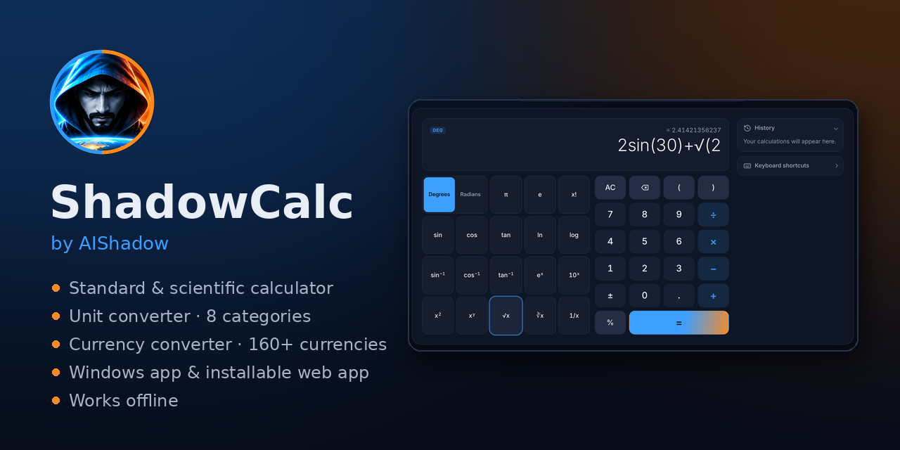
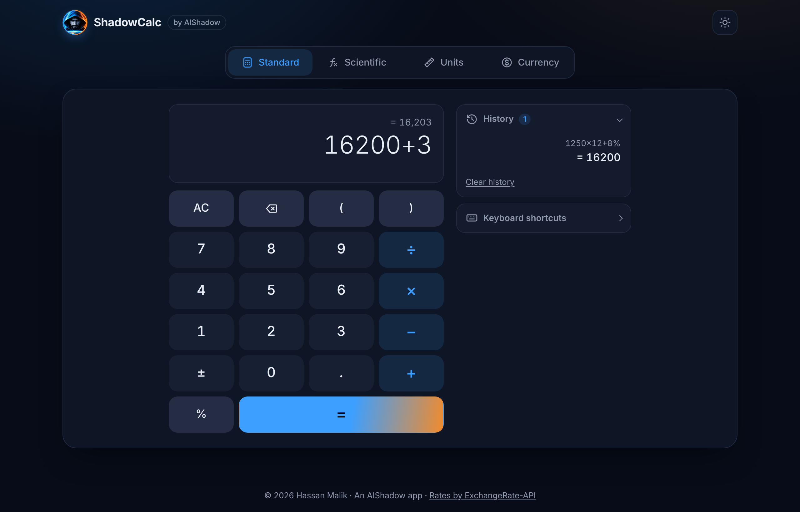
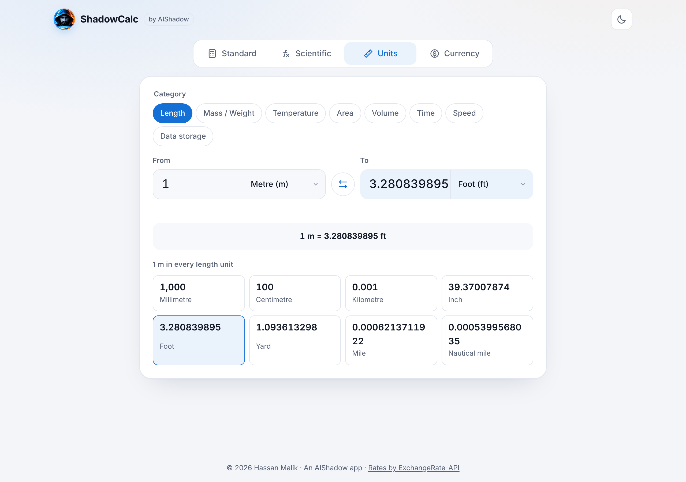
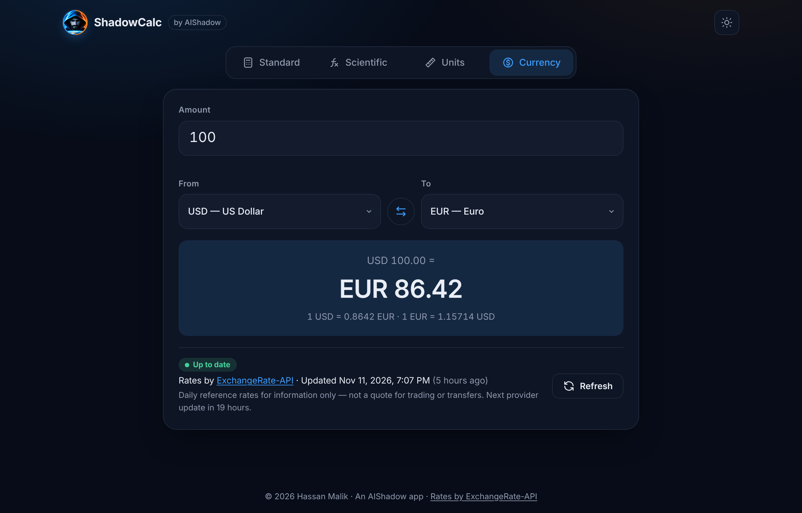
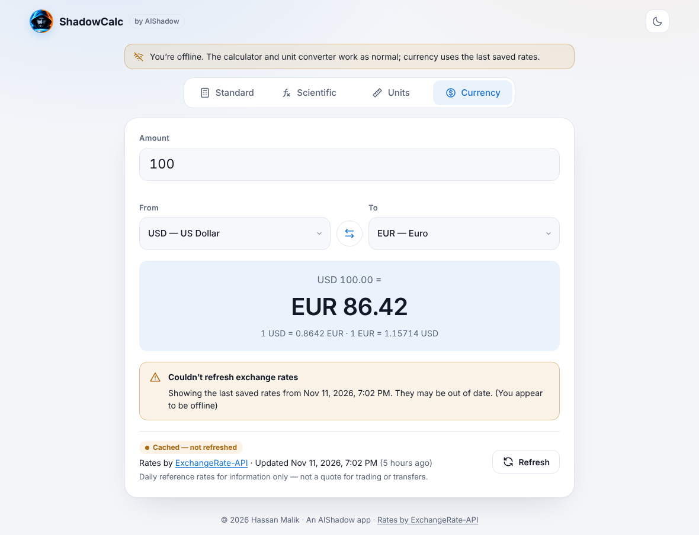
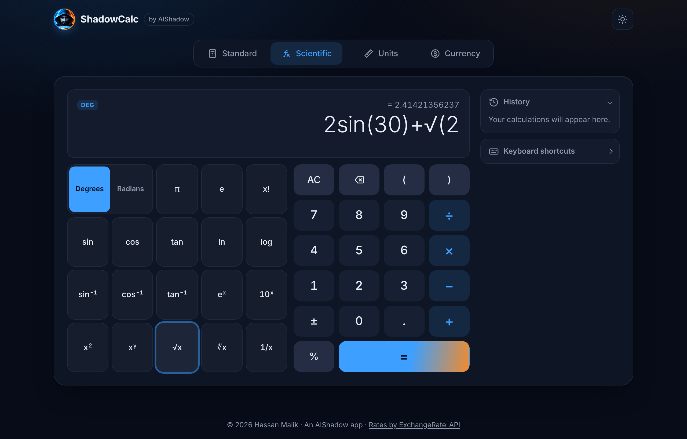
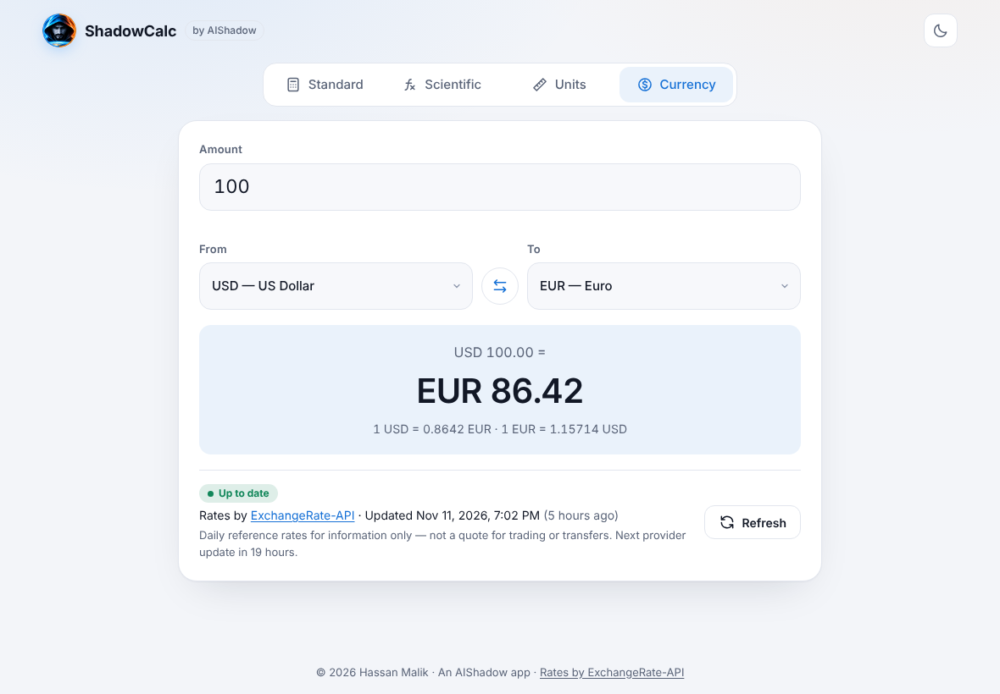
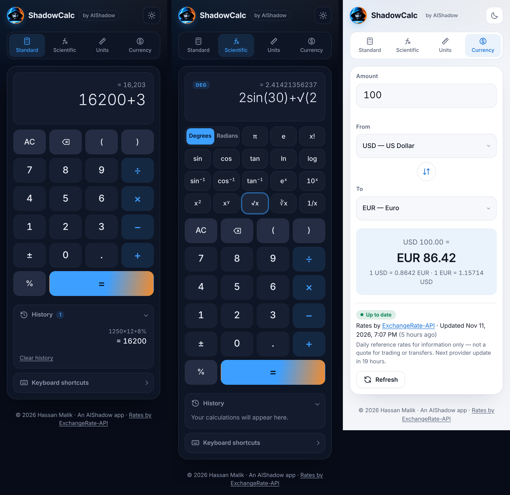

<p align="center">
  
</p>

<h1 align="center">ShadowCalc</h1>

<p align="center">
  <strong>by AIShadow</strong><br />
  Standard &amp; scientific calculator, unit converter and live currency converter.<br />
  A Windows desktop app and an installable web app, and it works offline.
</p>

<p align="center">
  
  
  
</p>

<p align="center">
  
</p>

## Download

| Platform | How to get it |
|---|---|
| **Windows 10/11** | Download **`ShadowCalc-Setup-1.0.0.exe`** from [Releases](https://github.com/YOUR_USERNAME/shadowcalc/releases) and run it. It adds a Start menu entry and a desktop shortcut. **`ShadowCalc-Portable-1.0.0.exe`** runs without installing. |
| **Android / desktop Chrome or Edge** | Open the [web app](https://YOUR_USERNAME.github.io/shadowcalc/) and press **Install app** in the header (or browser menu → *Install app*). |
| **iPhone / iPad** | Open the [web app](https://YOUR_USERNAME.github.io/shadowcalc/) in Safari → **Share** → **Add to Home Screen**. |

> Windows may show *“Windows protected your PC”* because the installer isn't code-signed yet. Click **More info → Run anyway**.

## Works offline

- **The calculator and unit converter** need no internet at all.
- **The currency converter** downloads the latest rates whenever you're online and saves them on your device. When you're offline, it uses the last saved rates and clearly shows the date they're from, plus a *You're offline* banner. It never presents old rates as current.
- **The web app** caches itself after your first visit, so it opens with no connection. The Windows app runs entirely from your PC.

---

## Features

### Standard calculator
- Addition, subtraction, multiplication, division, decimals, percentages, sign change (±), parentheses, clear and backspace.
- Correct operator precedence (`2+3×4 = 14`), implicit multiplication (`2(3+4)`, `2π`) and auto-closing of open brackets.
- Calculator-style percentages: `200 + 10% = 220`, `50 × 10% = 5`.
- A live result preview as you type, a calculation history (tap an entry to reuse it) and friendly errors such as *Cannot divide by zero*.
- Full keyboard support, with a built-in shortcuts reference.

### Scientific calculator
- `sin` `cos` `tan`, their inverses, `log` `ln`, `eˣ` `10ˣ`, `x²` `xʸ`, `√` `∛`, `1/x`, `x!`, and the constants `π` and `e`.
- A Degrees/Radians toggle, with exact results where expected (`sin(180°) = 0`, `sin⁻¹(0.5) = 30°`).
- Domain checking: `tan(90°)`, `log(0)`, `√(−4)` and `171!` show clear messages instead of `NaN` or `Infinity`.
- The function keys always sit next to the keypad on desktop and stack above it on phones. Nothing is hidden behind a menu.

### Unit converter
- **8 categories:** length, mass/weight, temperature, area, volume, time, speed and data storage (both decimal kB/MB/GB and binary KiB/MiB/GiB).
- Converts as you type, swaps units in one click, and shows the value in every unit of the category.
- Uses exact definitions (1 in = 0.0254 m, 1 lb = 0.45359237 kg) and rejects impossible input such as temperatures below absolute zero.

### Live currency converter
- Converts between about 160 currencies (including PKR, AED, SAR and INR) using the latest available rates.
- Always shows **the rate source and its last-updated time**, with an *Up to date* or *Cached — not refreshed* badge.
- If the rates can't be refreshed, the app shows the last saved rates with a clear warning. If nothing is saved, it shows an error with a retry button. **It never invents rates.**
- Needs no API key by default. You can optionally add a keyed provider through a small server-side endpoint, so the key never reaches the browser.

### Quality
- Light and dark themes (following the system setting by default), responsive from 320 px phones to wide desktops.
- Accessible: WAI-ARIA tabs with arrow-key navigation, labelled controls, screen-reader announcements for results and errors, visible focus, and reduced-motion support.
- **No `eval`:** expressions go through a hand-written tokenizer and a recursive-descent parser (ESLint enforces `no-eval` and `no-new-func`).
- **72 tests** covering the parser, the input model, unit conversions, currency failure handling, the server proxy and UI smoke flows.

<details>
<summary><strong>More screenshots</strong></summary>

| Standard | Unit converter |
|---|---|
|  |  |

| Currency | Offline, using saved rates |
|---|---|
|  |  |

| Scientific | Windows desktop app |
|---|---|
|  |  |



*The rates in the currency screenshots are illustrative.*
</details>

---

## Getting started

**Requirements:** Node.js 18.18 or later (20 or 22 recommended) and npm.

```bash
git clone https://github.com/YOUR_USERNAME/shadowcalc.git
cd shadowcalc
npm install
npm run dev
```

Open the URL Vite prints (usually http://localhost:5173).

### Scripts

| Command | What it does |
|---|---|
| `npm run dev` | Start the dev server with hot reload |
| `npm run desktop` | Build and open the Windows/desktop app (Electron) |
| `npm run dist:win` | Build the Windows installer and portable .exe into `release/` |
| `npm test` | Run the test suite once (`npm run test:watch` to watch) |
| `npm run lint` | Run ESLint |
| `npm run typecheck` | Run the TypeScript compiler in strict mode |
| `npm run build` | Type-check, build into `dist/` and generate the offline service worker |
| `npm run preview` | Serve the production build locally (static) |
| `npm start` | Serve `dist/` plus the optional `/api/rates` endpoint with Node |

---

## Currency configuration

The app tries these providers in order and uses the first one that answers:

| # | Provider | Key? | Coverage | Updates |
|---|---|---|---|---|
| 1 | Your server's `/api/rates` (only if `VITE_RATES_PROXY_URL` is set) | Server-side | Depends on provider | Depends on plan |
| 2 | [ExchangeRate-API open access](https://www.exchangerate-api.com/docs/free) | No | ~160 currencies | Once a day |
| 3 | [Frankfurter](https://frankfurter.dev) (European Central Bank) | No | ~30 currencies | Working days, ~16:00 CET |

**No setup is needed.** Rows 2 and 3 work straight away, including on static hosting such as GitHub Pages.

These are daily reference rates. They're fine for everyday conversions but aren't a quote for trading or money transfers, and the app says so.

### Optional: use a keyed provider (key stays on the server)

1. Create an account at [exchangerate-api.com](https://www.exchangerate-api.com) and copy your API key.
2. Create a `.env` file:
   ```bash
   cp .env.example .env
   ```
   ```ini
   EXCHANGE_RATE_API_KEY=your_secret_key   # server only, never bundled
   VITE_RATES_PROXY_URL=/api/rates         # tells the browser to use the proxy
   ```
3. Build and start the bundled server:
   ```bash
   npm run build
   npm start          # http://localhost:8787
   ```
   During development, run `npm run dev:server` in one terminal and `npm run dev` in another. Vite forwards `/api` to port 8787.

Check the configuration with `curl http://localhost:8787/api/health`, which reports `ratesConfigured: true` when the key is set.

`EXCHANGE_RATE_API_KEY` is read only by `server/`. Only variables that start with `VITE_` are put into the browser bundle, so don't put secrets in `VITE_` variables.

### Caching and failure behaviour
- Successful responses are saved in `localStorage` and reused for up to an hour, or until the provider's announced next update, whichever comes first.
- Requests time out after 8 seconds and fall through to the next provider.
- When the device is offline, or every provider fails, the last good rates are shown with an amber **Cached — not refreshed** notice, their original timestamp and the reason.
- When there are no saved rates, the app shows an error and a **Try again** button instead of a number.
- Rates refresh automatically when the browser comes back online.

---

## Architecture

```
src/
├── core/                     # Pure TypeScript: no React, fully unit-tested
│   ├── expression/           # tokenizer → recursive-descent parser → AST evaluator, formatting
│   ├── calculator/           # keypad input model (operator replacement, ±, history…)
│   ├── units/                # unit tables and conversion
│   └── currency/             # providers, cache, rates service, conversion
├── services/rates.ts         # wires the provider chain from env config
├── hooks/                    # React glue: useCalculator, useRates, useTheme, usePersistentState
├── components/               # presentation only
│   ├── calculator/           # Display, Key, Calculator (standard + scientific)
│   ├── converters/           # UnitConverter, CurrencyConverter
│   └── ModeTabs.tsx, icons/
└── styles/global.css         # design tokens, light/dark themes, responsive layout
electron/main.cjs             # Windows desktop shell (secure, serves the app from app://shadowcalc)
electron-builder.yml          # installer config (NSIS setup + portable exe)
scripts/build-sw.mjs          # generates the offline service worker after the build
public/manifest.webmanifest   # installable web app manifest + icons
build/                        # app & installer icons (from the AIShadow logo)
server/                       # optional zero-dependency Node server + rates proxy
tests/                        # Vitest + Testing Library
```

**Key decisions**

- **Logic is separate from presentation.** Everything in `src/core` is framework-free and covered by tests, so the parser or converters could move to another UI (React Native, CLI) unchanged.
- **The parser does not use `eval`.** Precedence from lowest to highest is `+ −` → `× ÷` (and implicit ×) → unary minus → `^` (right-associative) → postfix `! % ² ⁻¹`. This makes `−2^2 = −4`, matching standard mathematical notation.
- **The currency layer reports where its data came from.** Every snapshot carries its provider, the provider's update time and its precision (date or date-time), so the UI never shows a made-up timestamp.
- **There's no UI framework or CSS library.** The production JavaScript is about 84 kB gzipped, mostly React.

---

## Deployment

### Windows app (GitHub Releases)
Push a version tag and GitHub builds the installer for you on a Windows machine, then attaches it to a Release:
```bash
git tag v1.0.0
git push origin v1.0.0
```
To build it on your own PC instead, run `npm run dist:win`. The files appear in `release/`.

### GitHub Pages (static, no key required)
1. Push to a GitHub repository named `shadowcalc` on the `main` branch.
2. In **Settings → Pages**, set **Source** to **GitHub Actions**.
3. The included workflow (`.github/workflows/deploy-pages.yml`) tests, builds and publishes on every push to `main`.

The build uses relative asset paths, so it works under `/<repo-name>/` without extra configuration.

### Any Node host (Render, Railway, a VPS, etc.)
```bash
npm ci
npm run build                     # with a key: VITE_RATES_PROXY_URL=/api/rates npm run build
PORT=8080 EXCHANGE_RATE_API_KEY=your_key npm start   # omit the key to use key-less providers
```
The server sends security headers (including a hash-based Content-Security-Policy), caches hashed assets for a long time, falls back to the single-page app for unknown routes, and blocks path traversal.

---

## Keyboard shortcuts

| Keys | Action |
|---|---|
| `0–9` `.` | Digits, decimal point |
| `+` `-` `*` `/` | Operators |
| `(` `)` `%` | Parentheses, percent |
| `Enter` / `=` | Calculate |
| `Backspace` | Delete last entry |
| `Esc` / `Delete` | Clear |
| `F9` | Change sign |
| `^` `!` | Power, factorial *(scientific)* |
| `s` `c` `t` | sin, cos, tan *(scientific)* |
| `l` `g` `r` | ln, log, √ *(scientific)* |
| `p` `e` | π, e *(scientific)* |
| `←` `→` | Switch modes (when the tab bar is focused) |

---

## License

[MIT](LICENSE) © 2026 Hassan Malik · AIShadow

Exchange rates by [ExchangeRate-API](https://www.exchangerate-api.com) and [Frankfurter](https://frankfurter.dev).
